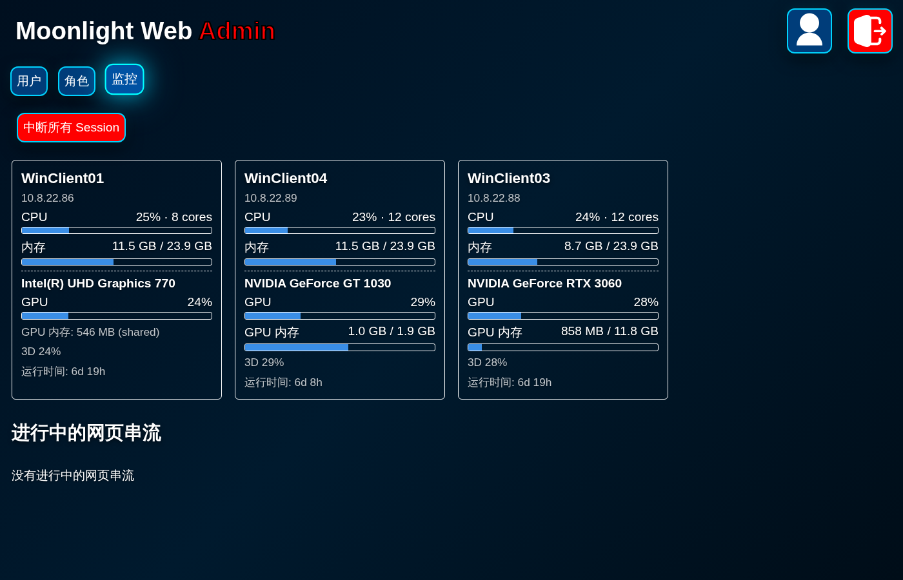

# Admin 監控分頁與 MwsAgent

這個 fork 以 [MrCreativ3001/moonlight-web-stream](https://github.com/MrCreativ3001/moonlight-web-stream) v2.10.0（GPL-3.0）為基礎，在 Admin 頁面加了「監控」分頁：

- 每 2 秒顯示每台 Sunshine/Apollo 主機的 CPU、記憶體、GPU 使用率、GPU 記憶體和開機時間。
- 列出目前這台 web server 上所有網頁串流（使用者、主機、App、開始時間）。
- 「中斷所有 Session」按鈕：停掉所有網頁串流，再對每台已配對主機送 `/cancel`。同一台主機上其他 Moonlight 用戶端（例如 iPad 原生 App）的連線也會一起斷。

主機數據由裝在 Windows 主機上的小型服務 `MwsAgent` 提供。



## 目錄

| 路徑 | 內容 |
|---|---|
| `src/api/admin.rs` | `GET /api/admin/monitor`、`POST /api/admin/terminate_all` |
| `src/app/streams.rs` | `StreamRegistry`：記錄執行中的串流，提供停止訊號 |
| `src/api/stream.rs` | 串流註冊、WebSocket heartbeat（10 秒 ping、30 秒逾時）、Close frame 處理、停止時 kill streamer |
| `common/src/config.rs` | 設定 `host_agent { port, token }` |
| `common/src/api_bindings.rs` | API 型別（`cargo test` 時由 ts-rs 產生 `web/api_bindings.ts`） |
| `web/component/monitor/index.ts` | 監控分頁 UI |
| `web/locales/*.ts`、`web/styles/*.css` | 文字和樣式 |
| `agent/windows/MwsAgent.cs` | Windows agent 原始碼 |
| `agent/windows/install.py` | 透過 WinRM 安裝或更新 agent |
| `agent/windows/winrm-ps.py` | 透過 WinRM 執行任意 PowerShell 檔（除錯用） |
| `deploy/Dockerfile` | Rust 建置映像（nightly-2026-02-13） |
| `deploy/deploy-prod.sh` | 部署到 pve02 的 LXC 104（mws） |
| `test/e2e/` | 端對端測試腳本和模擬主機 |

## 運作方式

### 監控

1. 瀏覽器每 2 秒呼叫 `GET /api/admin/monitor`，只有 admin 角色能用。
2. 後端列出這個 admin 看得到的主機（自己的和全域的），對每台主機的 `address:47995` 送 `GET /stats`，帶 `Authorization: Bearer <token>`，逾時 2 秒，回應上限 1 MB。
3. 只查自己和全域的主機，是為了不把 token 送到其他使用者新增的位址。
4. 沒設定 `host_agent.token` 時不連 agent，頁面顯示「agent 未啟用」。

### 中斷所有 Session

1. `StreamRegistry::stop_all()` 對每個串流送停止訊號。
2. 每個串流的 task 收到訊號後送 `ServerIpcMessage::Stop`，等 2 秒，關閉 WebSocket，再 kill streamer 子程序（streamer 還沒建立 transport 前會忽略 Stop，所以一定要 kill）。
3. 後端最多等 5 秒讓 registry 清空，避免還在啟動的 streamer 在 cancel 之後又把 App 開起來。
4. 對每台已配對主機呼叫上游原有的 `cancel_app`（nvhttp `/cancel`），每台逾時 10 秒，回傳每台的結果。

### 斷線清理（附帶修正）

上游版本在瀏覽器斷線後不會停掉 streamer，原本靠每天重啟服務清理。現在：

- 收到 WebSocket Close frame 時立即停止。
- 網路直接斷掉（沒有 Close frame）時，靠 heartbeat 在 30 秒內偵測，最晚約 45 秒清掉。

## 設定

`server/config.json` 加上：

```json
"host_agent": {
  "port": 47995,
  "token": "<與 agent.conf 相同的 token>"
}
```

兩個欄位都可省略：`port` 預設 47995；沒有 `token` 時監控停用，「中斷所有 Session」仍可用。

## MwsAgent（Windows）

- Windows 服務 `MwsAgent`，執行檔與設定在 `C:\ProgramData\MwsAgent\`（目錄只有 SYSTEM 和 Administrators 可讀）。
- 設定檔 `agent.conf`：

  ```
  port=47995
  token=<token>
  ```

- 每秒取樣一次：
  - CPU：PerformanceCounter
  - 記憶體：`GlobalMemoryStatusEx`
  - GPU 使用率：`GPU Engine` 計數器，算法和工作管理員相同
  - GPU 記憶體：`GPU Adapter Memory` 的 Dedicated/Shared Usage
  - 顯示卡名稱：DXGI
- `GET /stats` 回傳 JSON；token 錯誤或沒帶時回 401。
- 記錄寫在 `agent.log`，超過 1 MB 會輪替。
- 實測負擔：單核約 0.16%，記憶體約 41 MB。

### 安裝或更新

在 Linux 工作站上，需要 Python 套件 `pywinrm`，主機要開 WinRM（5985）：

```bash
python3 -m venv .venv && .venv/bin/pip install pywinrm
WPW='<Administrator 密碼>' AGENT_TOKEN_FILE=/home/ivan/src/mws-build/agent.token \
  .venv/bin/python agent/windows/install.py 10.8.22.86
```

腳本會做這些事：

1. 分段上傳原始碼（WinRM 命令列有長度限制，每段 2400 字元）。
2. 用 .NET Framework 內建的 `csc.exe` 編譯，建立服務並設定失敗時自動重啟。
3. 建立防火牆規則：只允許 10.8.22.94 連 TCP 47995。
4. 啟動服務，並在主機上確認帶 token 回 200、不帶 token 回 401。

可以重複執行，用來更新。

目前已安裝在 WinClient01、03、04（10.8.22.86、.88、.89）。

## 建置

Rust 用 Docker 建置，映像只需建一次：

```bash
sudo docker build -t mws-build deploy/
sudo docker run --rm -v "$PWD":/src -v mws-cargo:/opt/cargo/registry \
  -e CARGO_TARGET_DIR=/src/target-docker mws-build bash -c '
    cargo fmt --all --check &&
    cargo clippy --all-targets --all-features --locked -- -D warnings &&
    cargo test --workspace --locked &&
    cargo build --release --locked;
    chown -R 1000:1000 /src'
```

前端（`cargo test` 會先產生 `web/api_bindings.ts`）：

```bash
npm ci && npx tsc && npm run copy-static
```

打包給部署腳本用：

```bash
mkdir -p pkg && cp target-docker/release/web-server target-docker/release/streamer pkg/
cp -r dist pkg/static
tar -C pkg -czf mws-admin-<commit>.tgz .
```

## 部署

```bash
PKG=/path/to/mws-admin-<commit>.tgz AGENT_TOKEN_FILE=/path/to/agent.token bash deploy/deploy-prod.sh
```

腳本步驟：

1. 有網頁串流在跑時中止。
2. 備份到 `/opt/moonlight-web.bak-20261028` 和 `config.json.bak-20261028`。
3. 替換 binary 和 static。
4. 在 config 寫入 `host_agent`，重啟服務。
5. 用 curl 確認 `monitor.js` 回 200、未登入的 API 回 401。

還原步驟寫在腳本最後。

## 測試

| 項目 | 結果 |
|---|---|
| `cargo fmt` / `clippy -D warnings` / `cargo test`（105 個） / `tsc` | 通過 |
| 三台主機的 agent：帶 token 回 200，不帶回 401 | 通過 |
| 測試實例讀取三台主機數據；桌面和手機寬度截圖、無 JS 錯誤 | 通過 |
| 模擬主機：串流註冊、中斷全部（約 2 秒）、registry 和 streamer 清空、主機收到 `/cancel` | 通過 |
| Close frame（TCP 仍連著）立即停止；直接斷 TCP 在 45 秒內清掉 | 通過 |
| 對真實主機按「中斷所有 Session」 | **尚未測試** |

`test/e2e/` 的腳本是在 mws LXC 內對測試實例（`127.0.0.1:8081`，用 `X-Test-User` header 驗證）執行的。模擬主機只認得 `fakehost.py`，所以中斷測試不會碰到真實主機：

- `fakehost.py <cert> <key> <client-ca>`：模擬 nvhttp 主機（47989/47984）。
- `e2e.py`：斷線清理和中斷全部。
- `wsclose.py closeframe|frameonly|raw`：各種斷線方式（會從 `/root/e2e_helpers.py` 載入共用函式）。
- `shot.cjs <輸出目錄>`：用 playwright 截圖。playwright-core 和 chromium 的路徑寫死在檔案裡。

## Review 紀錄

另一個 session 做了兩輪 review，共提出 13 項，修正 11 項。沒有修的兩項：

- **監控只列自己和全域的主機，不列所有使用者的主機**：目前只有一個使用者；而且這樣 token 不會送到其他使用者新增的位址。
- **agent 閒置時仍每秒取樣**：實測負擔可以忽略。

## 已知問題

- WinClient04（.89）從非 10.8.22.94 的位址連 47995 會收到 401，不是被防火牆擋下，代表那台的 Windows 防火牆規則沒有實際生效，目前只靠 token 保護。
- 斷線清理修好後，每天的 `moonlight-web-restart.timer` 可能已經不需要，目前仍保留。
- 上游已有 v3.x，這個 fork 停在 v2.10.0。

## License

上游是 GPL-3.0，這個 fork 沿用。內部使用不需要公開原始碼；把修改後的程式提供給他人時，需要一起提供原始碼。`MwsAgent` 是透過 HTTP 溝通的獨立程式。
